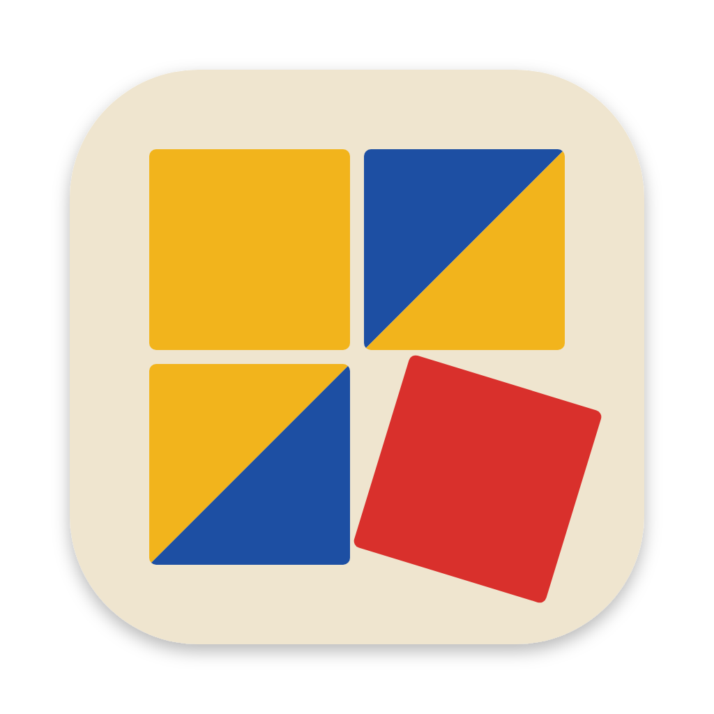
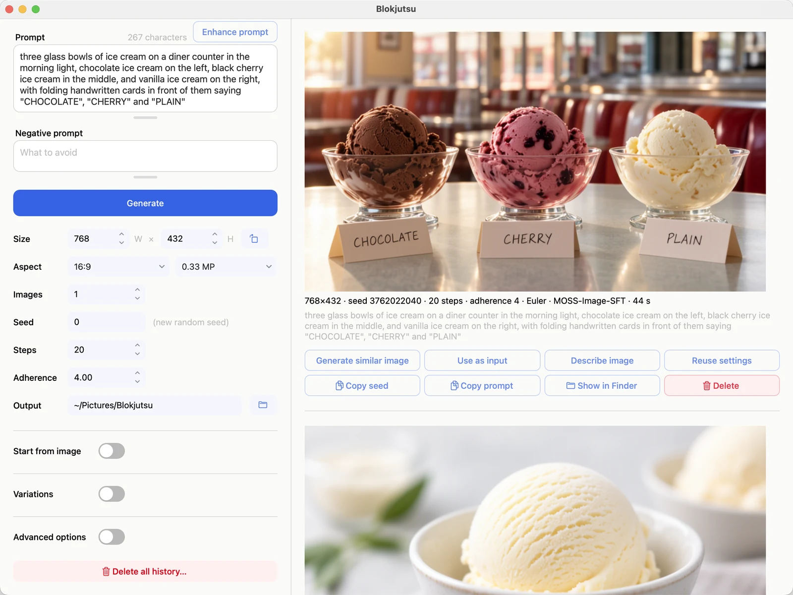

<p align="center"></p>

# Blokjutsu

**A local, permissively licensed, open-source Mac app for generating and editing images from text prompts with
the open-weight [MOSS-Image](https://github.com/OpenMOSS/MOSS-Image) model.**

[](https://github.com/formdo/blokjutsu/releases/download/v1.0.0rc3/Blokjutsu-1.0.0rc3.dmg)
[](https://formdo.github.io/blokjutsu/)

To use Blokjutsu, download it and start with the [User's Guide](https://formdo.github.io/blokjutsu/). The rest of
this page is for developers.



## What it is

- **A Mac app** (PySide6/Qt) around MOSS-Image's diffusers pipeline, running on the Apple GPU through PyTorch's
  MPS backend: text to image, image to image, variations, inpainting, outpainting, cropping, and upscaling, with
  live previews and a scrolling history
- **Describe image and Enhance prompt,** written by MOSS-Image's own text encoder (Qwen3.5-9B) with its output
  layer re-attached
- **Local:** models are downloaded once, on request, from a separate process; the app itself runs with the Hugging
  Face libraries in offline mode and never goes online
- **Open source all the way down:** the app, MOSS-Image's code, and its weights are all under the
  [Apache License 2.0](LICENSE), a
  [permissive](https://en.wikipedia.org/wiki/Comparison_of_free_and_open-source_software_licenses) license

## Requirements

- A Mac with Apple silicon (M1 or later) and macOS 12.3 or later
- 32 GB of memory or more; 48 GB or more is comfortable
- About 40 GB of free disk space, mostly for the model

## Install

**Disk image:** the [Download for Mac](https://github.com/formdo/blokjutsu/releases/download/v1.0.0rc3/Blokjutsu-1.0.0rc3.dmg) button above (1.0.0rc3, about 360 MB). Open it and drag Blokjutsu to
Applications.

**Terminal installer:** installs a private Python with the tested library versions into
`~/Library/Application Support/Blokjutsu.noindex/` and builds `~/Applications/Blokjutsu.app`. Nothing else on
the Mac is changed. [Read it](docs/install.sh) first if you like.

```sh
curl -LsSf https://formdo.github.io/blokjutsu/install.sh | sh
```

To uninstall the app it installed (keeping images, settings, and the model):

```sh
curl -LsSf https://formdo.github.io/blokjutsu/install.sh | sh -s -- --uninstall
```

**From PyPI:** Blokjutsu needs Python 3.10 or later; a virtual environment is strongly recommended. The exact
library versions it was tested with are in [constraints.txt](constraints.txt), which pip can use with
`-c constraints.txt`.

```sh
python3 -m venv .venv
source .venv/bin/activate
pip install blokjutsu
blokjutsu
```

## Contributing

[CONTRIBUTING.md](CONTRIBUTING.md) covers setting up a development environment, running the tests, the design
and modules, building the .dmg, and releasing. The User's Guide's
[Technical notes](https://formdo.github.io/blokjutsu/developers.html#technical-notes) explain how each control works.

## Built on MOSS-Image

Blokjutsu is an independent desktop front end for **MOSS-Image**, the text-to-image model and pipeline by the
[OpenMOSS Team](https://github.com/OpenMOSS) and [MOSI.AI](https://mosi.cn/). Blokjutsu is not affiliated with or
endorsed by them. All of the image-making is theirs.

- Repository: https://github.com/OpenMOSS/MOSS-Image
- Technical report: https://arxiv.org/abs/2610.23374
- User guide: https://github.com/OpenMOSS/MOSS-Image/blob/main/USERGUIDE.md

If you use images or results from Blokjutsu in research, please cite MOSS-Image:

```bibtex
@misc{mossimage2026,
  title        = {MOSS-Image},
  author       = {{OpenMOSS Team}},
  year         = {2026},
  howpublished = {\url{https://github.com/OpenMOSS/MOSS-Image}}
}
@misc{mossimage2026report,
  title         = {MOSS-Image Technical Report},
  author        = {{MOSI.AI}},
  year          = {2026},
  eprint        = {2610.23374},
  archivePrefix = {arXiv},
  url           = {https://arxiv.org/abs/2610.23374}
}
```

## What it uses

The models are downloaded from [Hugging Face](https://huggingface.co), a site that hosts open AI models, and
only when you ask. MOSS-Image's model is published there as MOSS-Image-SFT; its text encoder and image decoder
come from Qwen and FLUX.2 and are included in that download.

| model | by | license | role |
|---|---|---|---|
| [MOSS-Image-SFT](https://huggingface.co/OpenMOSS-Team/MOSS-Image-SFT) | OpenMOSS Team | Apache-2.0 | MOSS-Image's model, used by default |
| [MOSS-Image-Base](https://huggingface.co/OpenMOSS-Team/MOSS-Image-Base) | OpenMOSS Team | Apache-2.0 | the untuned model, for people training their own versions (optional) |
| [Qwen3.5-9B](https://huggingface.co/Qwen/Qwen3.5-9B) | Qwen Team, Alibaba Cloud | Apache-2.0 | reads prompts (part of MOSS-Image); with its output layer, downloaded separately, writes descriptions |
| [FLUX.2 VAE](https://github.com/black-forest-labs/flux2) | Black Forest Labs | Apache-2.0 | turns the model's output into pixels (part of MOSS-Image) |

Python libraries, installed alongside:

| library | license | role |
|---|---|---|
| [PyTorch](https://pytorch.org), torchvision | BSD-3-Clause | numerical engine on the Apple GPU |
| [Diffusers](https://github.com/huggingface/diffusers) | Apache-2.0 | runs the MOSS-Image pipeline |
| [Transformers](https://github.com/huggingface/transformers), Accelerate | Apache-2.0 | text encoder, describing |
| [huggingface_hub](https://github.com/huggingface/huggingface_hub), safetensors | Apache-2.0 | model files and downloads |
| [httpx](https://www.python-httpx.org) | BSD-3-Clause | the confirmed downloads |
| [PySide6 / Qt](https://www.qt.io/qt-for-python) | LGPL-3.0 | the window and controls |
| [Pillow](https://python-pillow.org) | MIT-CMU | image files |
| [NumPy](https://numpy.org) | BSD-3-Clause | arrays |
| [PyObjC](https://github.com/ronaldoussoren/pyobjc) | MIT | macOS system icons and app name |

## Local by design

Blokjutsu uses the internet only to download the models, once, and only after a confirmation dialog; it does not
go online to generate, edit, or store images, or to check for updates. Everything it writes is kept in
`~/Library/Application Support/Blokjutsu.noindex`, out of Time Machine backups and Spotlight, and PNGs hold only
the image unless the user turns on Settings in PNG. The User's Guide's
[Running locally](https://formdo.github.io/blokjutsu/local.html) lists every file and what Delete all history does
with it.

## Roadmap

What comes next is in [ROADMAP.md](ROADMAP.md).

## Bug reports and feature requests

Please report bugs and request features as [GitHub issues](https://github.com/formdo/blokjutsu/issues). For help
using Blokjutsu, see the [User's Guide](https://formdo.github.io/blokjutsu/) and its
[Frequently asked questions](https://formdo.github.io/blokjutsu/faq.html#when-something-goes-wrong) page.

## Etymology

**Blokjutsu** (BLOK-joot-soo, /ˈblɒk.dʒuː.tsuː/), *noun*. The art of the block.

From Danish *blok*, "block," and Japanese *jutsu* (術, じゅつ), "art" or "technique." The name comes from how
MOSS-Image works: it treats an image as blocks of pixels, each 16 × 16 square one unit for the model, and
transforms them step by step from noise into the finished image.

## Design inspiration

The block designs in the icon and the app draw on

- the [Kohs block design test](https://en.wikipedia.org/wiki/Kohs_block_design_test), introduced by Samuel C.
  Kohs in 1920: colored cubes, some faces split diagonally, arranged to match a pattern
- [Froebel's gifts](https://en.wikipedia.org/wiki/Froebel_gifts), the wooden building blocks of Friedrich
  Fröbel's first kindergartens
- the primary colors and simple geometry of the [Bauhaus](https://en.wikipedia.org/wiki/Bauhaus)

## Authors

Blokjutsu was written by Bob Carpenter together with Claude, Anthropic's AI model.

## License

Copyright 2026 Bob Carpenter. Apache License 2.0; see [LICENSE](LICENSE) and [NOTICE](NOTICE).
`blokjutsu/moss_image.py` is MOSS-Image's pipeline code, copied unchanged, and `blokjutsu/moss_forward.py` is
adapted from it (both Apache-2.0). "MOSS-Image" is the OpenMOSS Team's name and is used here only to say what
this app runs.
