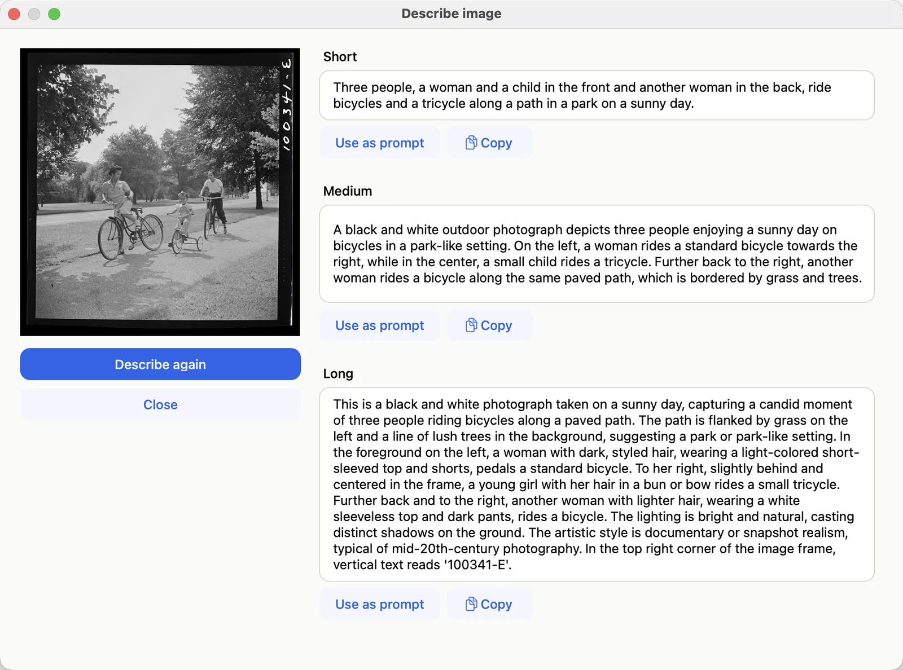

# Describing images

**Describe image** writes descriptions of a picture: a short one, a medium one, and a long one. It's MOSS-Image
read in reverse, image to text, written by the same text encoder that reads your prompts, on your Mac like
everything else.

Describe image on a 1942 photograph. The long description even reads the negative number in the corner.
*Photograph: Marjory Collins, "Sunday cyclists in East Potomac Park, Washington, D.C.", June–July 1942. Library of
Congress, Farm Security Administration/Office of War Information collection; public domain.
[loc.gov/item/2017825632](https://www.loc.gov/item/2017825632/){:target="_blank"}*

## Where to find it

- **Describe image** on any picture in your history
- **Describe image** under the picture in **Start from image**

Each description has **Use as prompt**, which puts it in the prompt box (⌘Z brings your own prompt back), and
**Copy**. **Describe again** writes a fresh set.

## What it's good for

- **A prompt for something similar:** describe a picture you like, then edit the description.
- **Changing a picture:** with **Start from image**, a description of the picture as it is makes a good base for
  the prompt; change only the part you want different.
- **Upscaling:** the description of a picture is a good prompt when [making it bigger](from-a-picture.md#upscaling-making-a-picture-bigger).

## Good to know

- **The first time,** Blokjutsu asks to download one more piece of the model (2 GB).
- **Time:** a few seconds to a minute. With **Think first** (in Advanced options) the model plans before writing:
  slower, often several minutes, and sometimes more accurate.
- **Watermarks** are named under the descriptions, not described in them, so a prompt made from a description
  doesn't ask for one.
- **Text in the picture** is transcribed as written, in its own language, and the long description says where it is.

Its sibling, **Enhance prompt**, turns a short prompt into the same three lengths of description; see
[Writing prompts](prompts.md#let-the-model-help).
