# Examples

Each grid below changes one setting and keeps everything else fixed, so you can see what that setting does.
Click any image to see it full size. The images are exactly as Blokjutsu made them, saved without loss.

## Samplers and steps

The four [samplers](controls.md#samplers) at 5, 10, 20, 30, and 50 steps, all with the same prompt and seed:

> side view of a red tabby Maine coon cat lying on a bed in a ray of sunshine in the afternoon, shabby chic, 35mm
> film grain

512 × 512, Adherence 4, seed 1932434153, Advanced options at their defaults.

<table class="examples">
  <tr><th></th><th>5 steps</th><th>10 steps</th><th>20 steps</th><th>30 steps</th><th>50 steps</th></tr>
  <tr><th>Euler</th><td><a href="assets/examples/samplers/Euler-05.webp">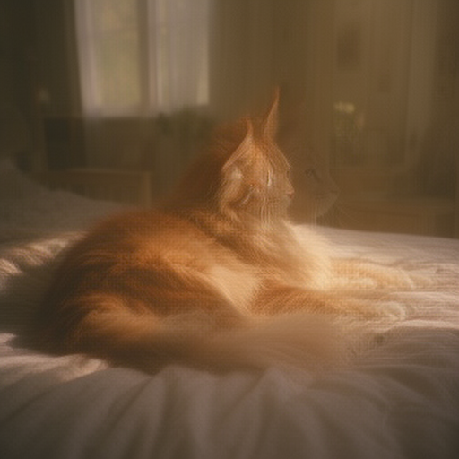</a></td><td><a href="assets/examples/samplers/Euler-10.webp">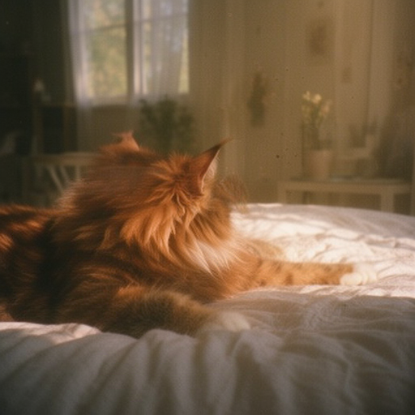</a></td><td><a href="assets/examples/samplers/Euler-20.webp">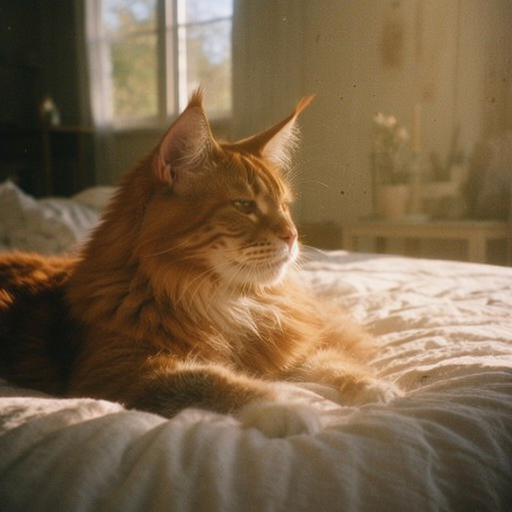</a></td><td><a href="assets/examples/samplers/Euler-30.webp">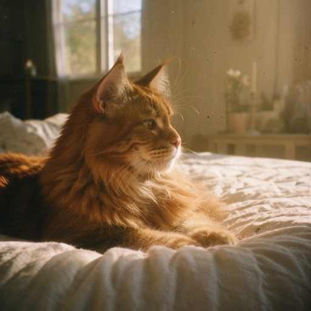</a></td><td><a href="assets/examples/samplers/Euler-50.webp">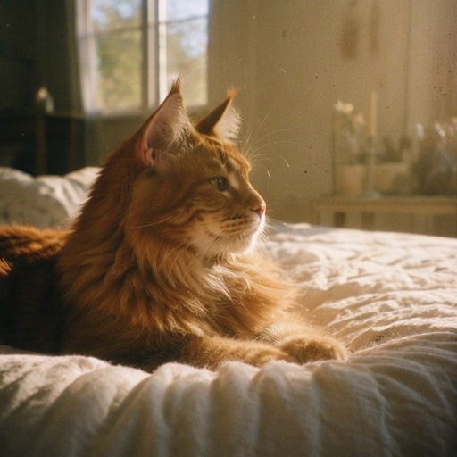</a></td></tr>
  <tr><th>Euler SDE</th><td><a href="assets/examples/samplers/SDE-05.webp">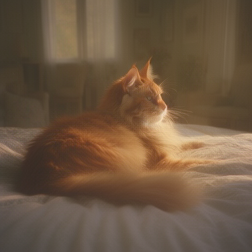</a></td><td><a href="assets/examples/samplers/SDE-10.webp">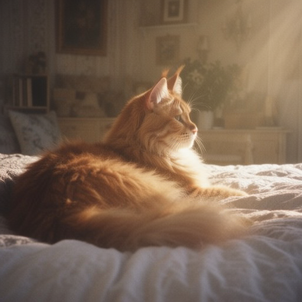</a></td><td><a href="assets/examples/samplers/SDE-20.webp">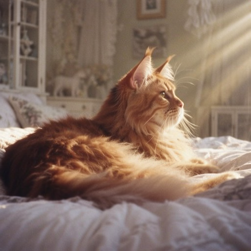</a></td><td><a href="assets/examples/samplers/SDE-30.webp">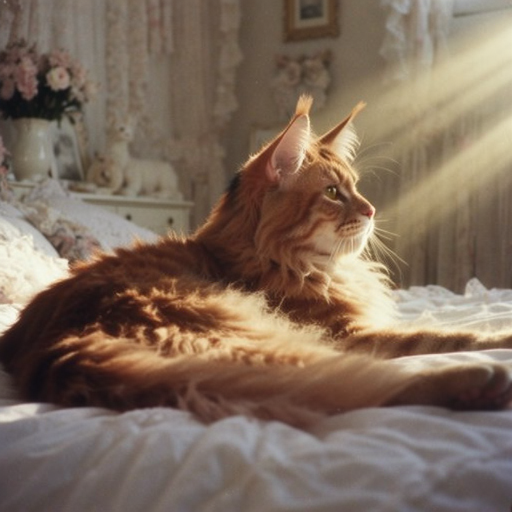</a></td><td><a href="assets/examples/samplers/SDE-50.webp">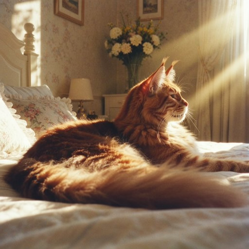</a></td></tr>
  <tr><th>DPM++ 2M</th><td><a href="assets/examples/samplers/DPM-05.webp">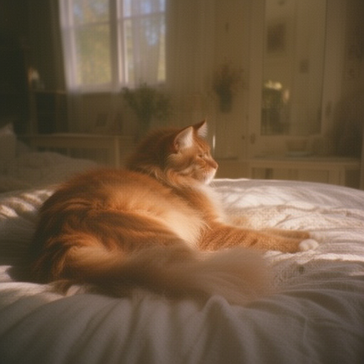</a></td><td><a href="assets/examples/samplers/DPM-10.webp">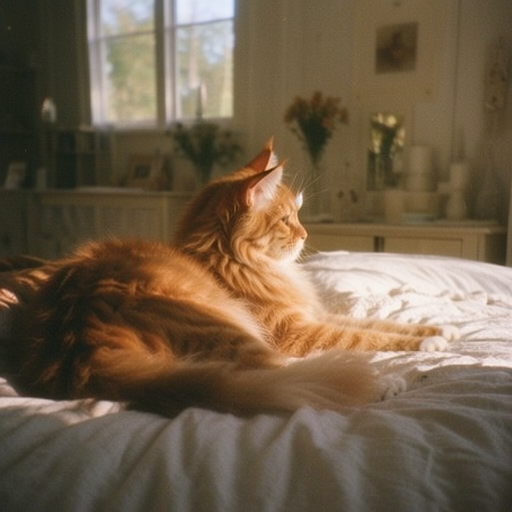</a></td><td><a href="assets/examples/samplers/DPM-20.webp">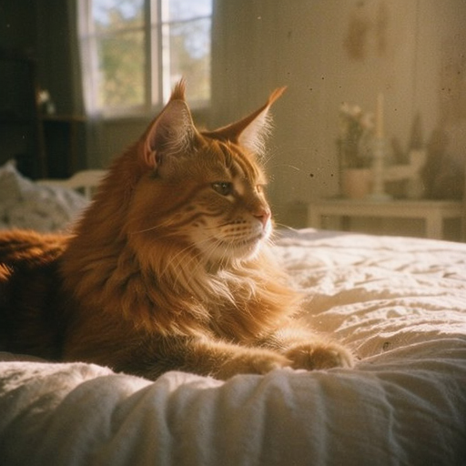</a></td><td><a href="assets/examples/samplers/DPM-30.webp">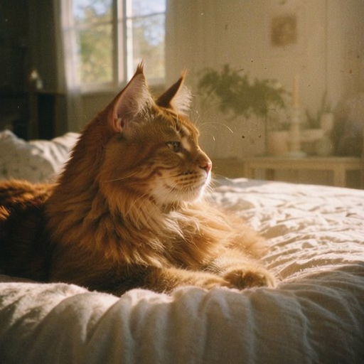</a></td><td><a href="assets/examples/samplers/DPM-50.webp">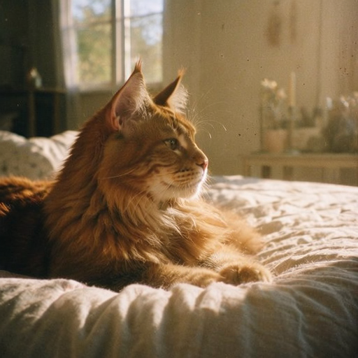</a></td></tr>
  <tr><th>UniPC</th><td><a href="assets/examples/samplers/UniPC-05.webp">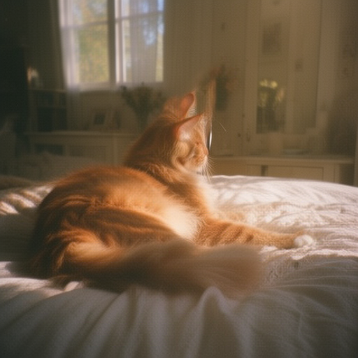</a></td><td><a href="assets/examples/samplers/UniPC-10.webp">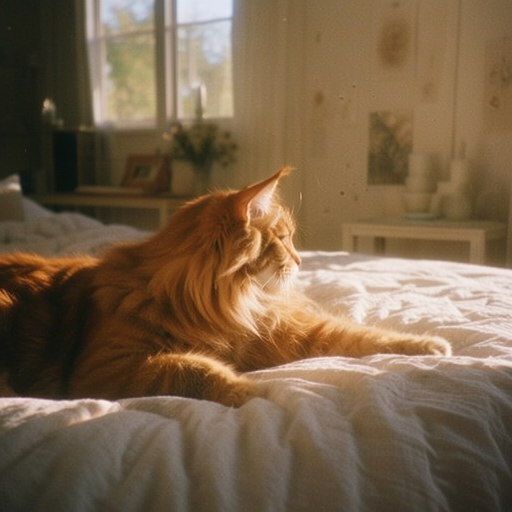</a></td><td><a href="assets/examples/samplers/UniPC-20.webp">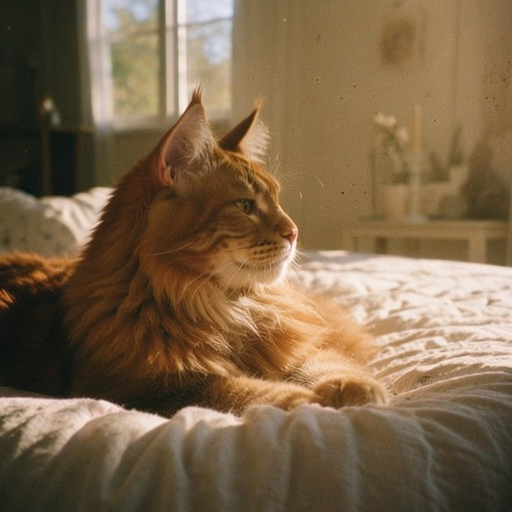</a></td><td><a href="assets/examples/samplers/UniPC-30.webp">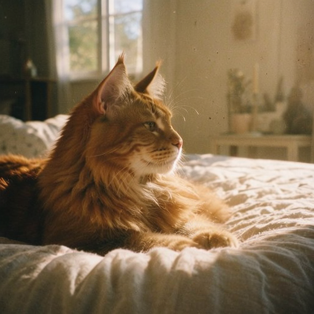</a></td><td><a href="assets/examples/samplers/UniPC-50.webp">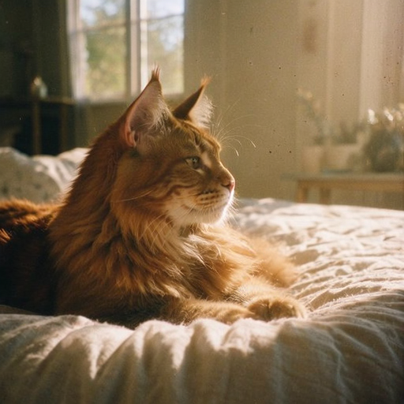</a></td></tr>
</table>

What to notice:

- **Euler, DPM++ 2M, and UniPC settle on the same picture.** By 20 steps the three are almost identical, and
  30 or 50 steps add little more for this prompt.
- **DPM++ 2M and UniPC are usable at 10 steps,** while Euler is still hazy. Their 10-step pictures are sharp,
  though the cat's pose and the framing differ from the settled picture.
- **At 5 steps, every sampler is still soft and blurry.**
- **Euler SDE keeps changing as the steps go up,** because it adds fresh randomness at every step. Here it drifted
  toward a busier room with a visible sunbeam, arguably closer to "shabby chic" and "a ray of sunshine," but a
  different picture from the others.

So for this prompt, 20 steps with any of the first three is enough, and 30 is a safe choice in general. DPM++ 2M
at 10 steps is a quick preview of the idea, though not of the exact picture you'd get with more steps.

## Adherence

**Adherence** at 1, 2, 4, 6, 8, and 16, with the same prompt and seed. 1152 × 864, 40 steps.

> dynamic two page spread of irregularly sized and arranged interlocking panels from a manga, mix of portrait and
> landscape, an establishing shot of a house and the suburbs, a second with older people at home looking worried,
> a scene with a schoolgirl on the subway, a sedan driving down the highway alone, a large panel of a
> samurai-styled superhero on the left with a horizontally striped costume in traditional autumn colors leaping
> toward a giant original insect head mechanical body mecha with four eyes on the right towering over the
> superhero with the superhero swinging a katana overhead with two hands in the middle of downtown Tokyo, another
> panel has an aircraft carrier with two fighter jets taking off, a tiny panel has a close up of a fighter jet pilot
> flying with a helmet in the canopy in the air, another small panel has a worried looking older military general
> with his hat on, pen and ink with watercolor and japanese text and thought bubbles, 1970s subtle and light manga
> style

Negative prompt: *dark, monochrome, Gundam*

<table class="examples">
  <tr><td><a href="assets/examples/adherence/manga-01.webp">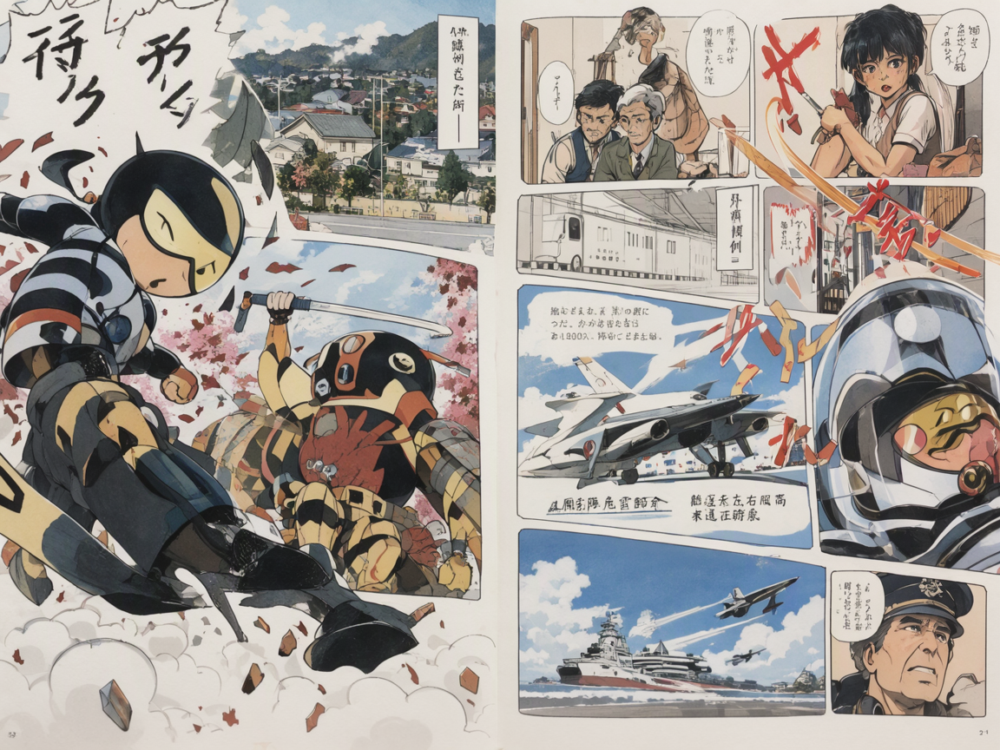</a> Adherence 1</td><td><a href="assets/examples/adherence/manga-02.webp">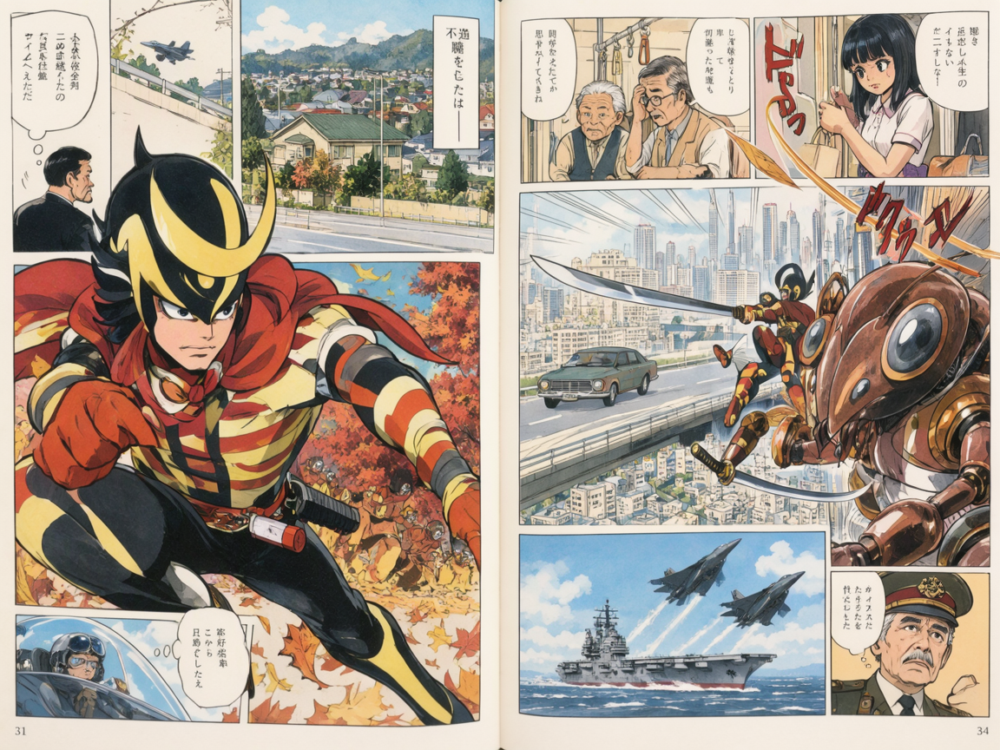</a> Adherence 2</td><td><a href="assets/examples/adherence/manga-04.webp">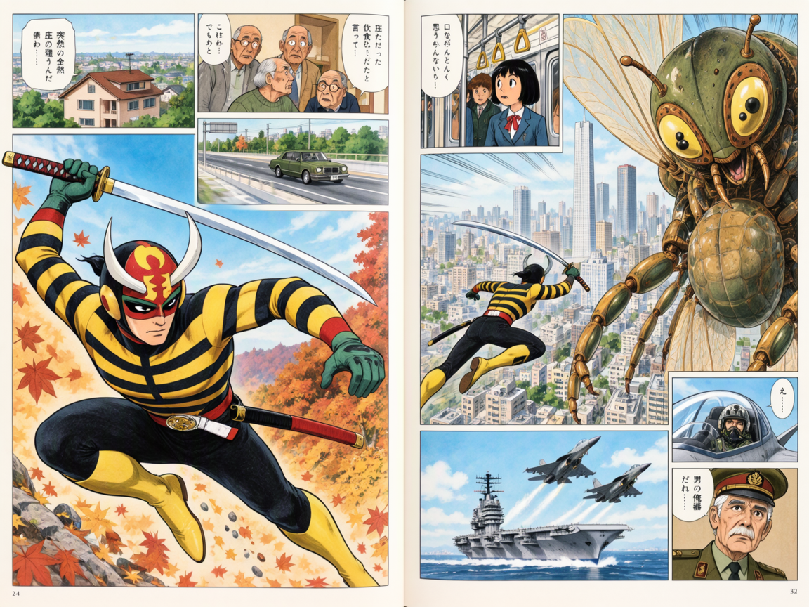</a> Adherence 4</td></tr>
  <tr><td><a href="assets/examples/adherence/manga-06.webp">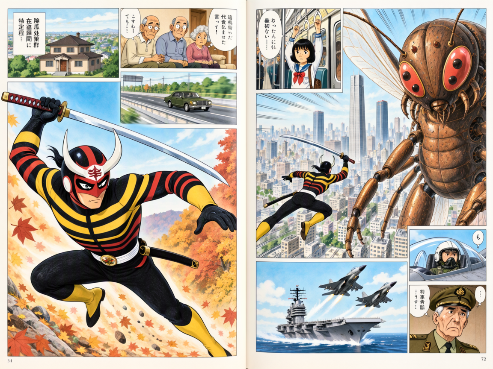</a> Adherence 6</td><td><a href="assets/examples/adherence/manga-08.webp">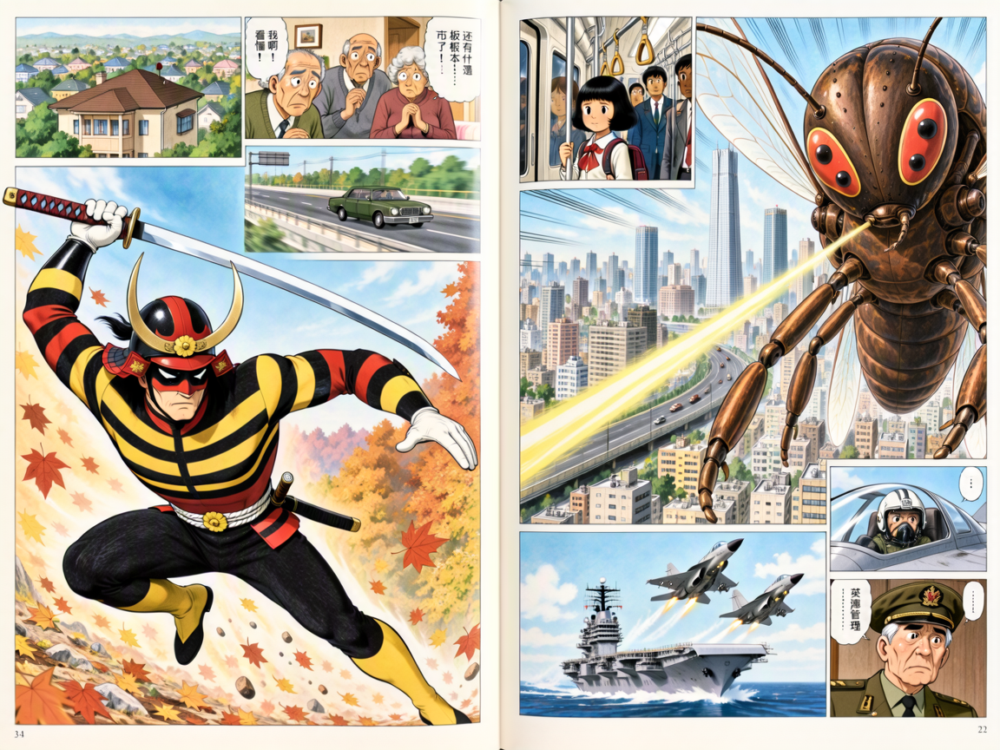</a> Adherence 8</td><td><a href="assets/examples/adherence/manga-16.webp">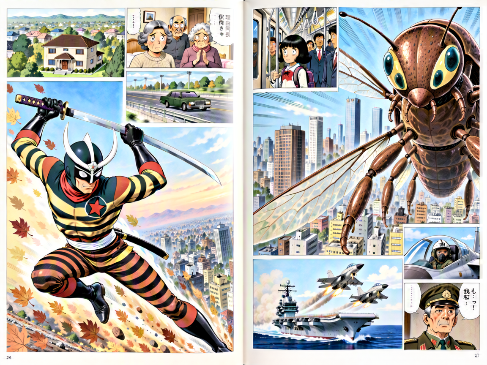</a> Adherence 16</td></tr>
</table>

What to notice:

- **At 1, guidance is off.** Each step takes half the time, but the picture barely follows the prompt: the
  panels run together and most of the listed scenes are missing.
- **At 2, the scenes appear,** but loosely drawn and in a different style.
- **From 4 to 8, every listed panel is there,** and the pictures differ mainly in detail. 4 is the sweet spot, and
  anything from 3 to 6 gives much the same result.
- **At 16, colors and lines get harsh.** Very high or very low values add artifacts.

The Japanese lettering is decoration: MOSS-Image writes plausible-looking fragments, not real dialogue, and at
Adherence 8 some bubbles drift into Chinese. To get
exact words, in any language, put them in the prompt in quotation marks (see [Writing prompts](prompts.md#text-in-pictures)).

## Size

The same prompt and seed at six sizes, from 384 × 256 (0.1 MP) to 2496 × 1664 (4.2 MP). 50 steps, Adherence 4.

> a crowded European street scene in which two college boys in matching maize and blue hoodies saying "Michigan"
> and matching maize and blue hats with an M on them in yellow, recording a tik-tok video where a vertical phone on a
> tripod is facing toward them, the student on the left is throwing a basketball in a push throw with both hands
> toward the head of the student on the right, the ball shows motion blur as does the thrower's hands anda arms, the
> receiver on the right looks shocked and afraid as the ball moves toward his head, the background is a bridge over
> a river in Europe with a crowd of pedestrians in the background staring at them

Negative prompt: *blurry, low quality*

<table class="examples">
  <tr><td><a href="assets/examples/sizes/basketball-0384.webp">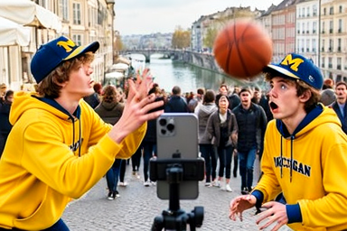</a> 384 × 256 (0.1 MP)</td><td><a href="assets/examples/sizes/basketball-0768.webp">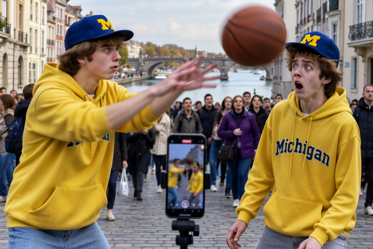</a> 768 × 512 (0.4 MP)</td><td><a href="assets/examples/sizes/basketball-1152.webp">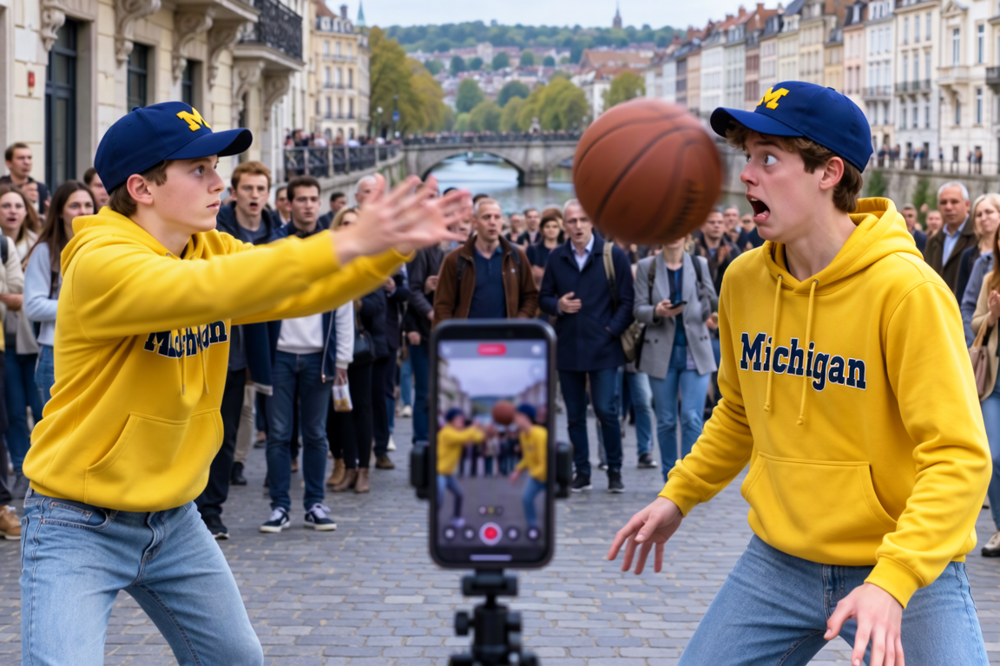</a> 1152 × 768 (0.9 MP)</td></tr>
  <tr><td><a href="assets/examples/sizes/basketball-1536.webp">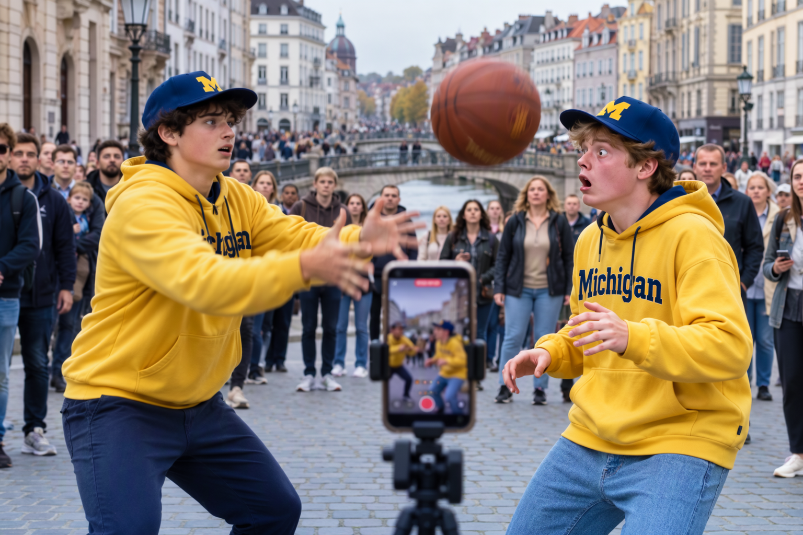</a> 1536 × 1024 (1.6 MP)</td><td><a href="assets/examples/sizes/basketball-1920.webp">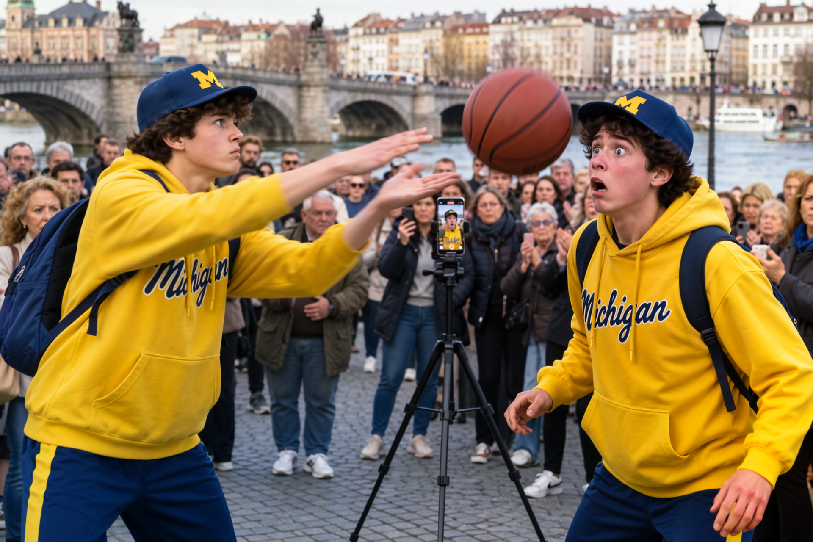</a> 1920 × 1280 (2.5 MP)</td><td><a href="assets/examples/sizes/basketball-2496.webp">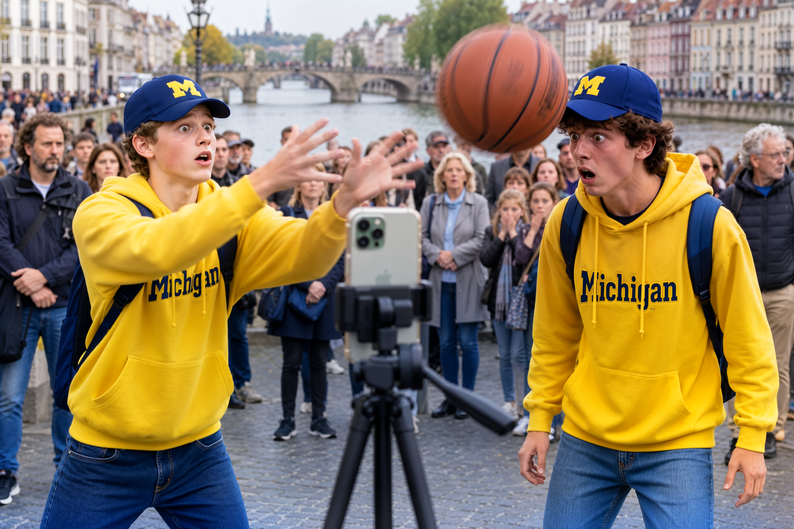</a> 2496 × 1664 (4.2 MP)</td></tr>
</table>

What to notice:

- **The picture changes with the size,** not just its sharpness: the same seed gives a different arrangement at
  each size.
- **Around 1 MP and up, MOSS-Image does noticeably better,** even allowing for the extra pixels: proportions,
  hands, the lettering, and the details the prompt asks for (the phone on its tripod, the crowd on the bridge)
  come out right more often. Small sizes are fine for trying out an idea.

## Variations

**Variations** at strengths 0, 0.10, 0.25, 0.50, 0.75, and 1.00, all from the same picture: the cat seed from
[Samplers and steps](#samplers-and-steps) with a new prompt. 512 × 512, Adherence 4.

> side view of a red tabby Maine coon cat lying on a bed in moonbeam, sleek modern apartment, digital RAW

<table class="examples">
  <tr><td><a href="assets/examples/variations/variation-000.webp">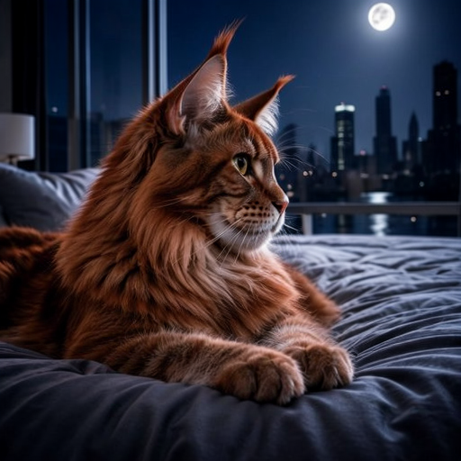</a> 0 (the original)</td><td> 0.10</td><td> 0.25</td></tr>
  <tr><td> 0.50</td><td><a href="assets/examples/variations/variation-075.webp">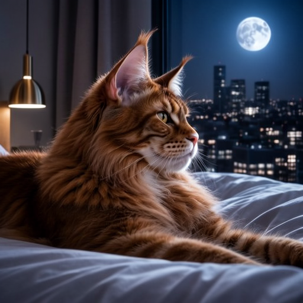</a> 0.75</td><td><a href="assets/examples/variations/variation-100.webp">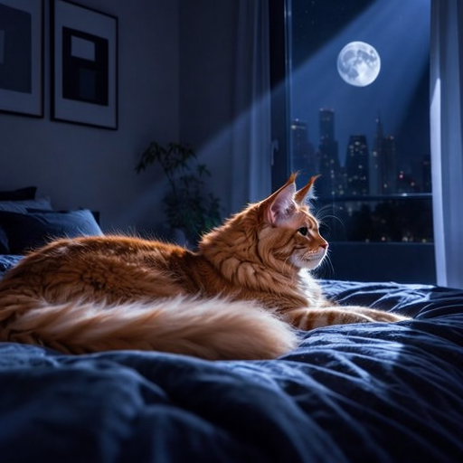</a> 1.00</td></tr>
</table>

What to notice:

- **Up to about 0.25, it's the same picture** with small changes: the skyline, the moon, the fur.
- **At 0.5 and 0.75, the room and the light change** while the idea stays.
- **At 1.0, it's a new picture,** as different as a new seed.

## Starting from a picture

A 1909–1911 baseball card of Cy Young as the starting picture, at **Change** 0.25, 0.50, 0.75, 0.85, 0.90, 0.95,
and 0.98. 368 × 640, 100 steps.

> modern color photograph of a baseball pitcher from 1910 shown just after releasing a ball in the golden hour on a
> field of green that goes to the horizon about midway up the background. He is wearing a white pinstrpied shirt and
> pants, black belt, and a neon blue shirt under the grey shirt with a blue collar sticking out and blue sleeves
> extending past the short grey sleeves, and a hat that is neon blue with a "Z" on it

<table class="examples">
  <tr><td><a href="assets/examples/from-image/cy-young-000.jpg">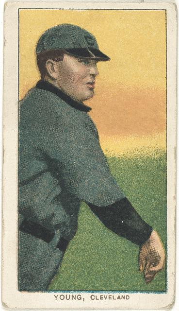</a> the original card</td><td><a href="assets/examples/from-image/cy-young-025.webp">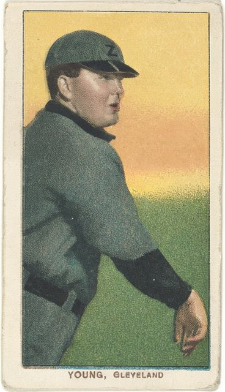</a> Change 0.25</td><td><a href="assets/examples/from-image/cy-young-050.webp">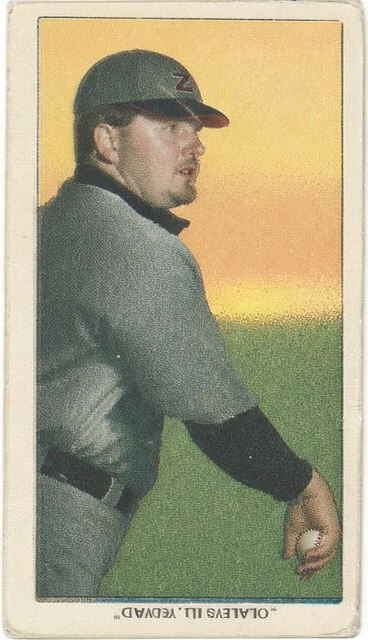</a> 0.50</td><td><a href="assets/examples/from-image/cy-young-075.webp">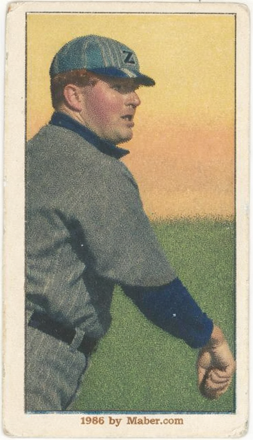</a> 0.75</td></tr>
  <tr><td><a href="assets/examples/from-image/cy-young-085.webp">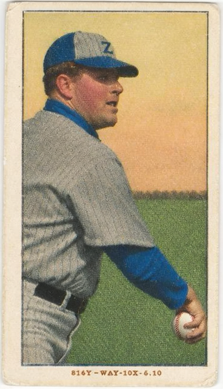</a> 0.85</td><td><a href="assets/examples/from-image/cy-young-090.webp">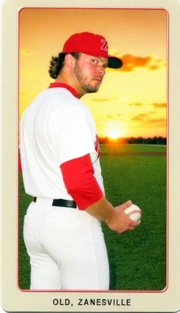</a> 0.90</td><td><a href="assets/examples/from-image/cy-young-095.webp">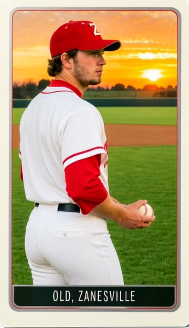</a> 0.95</td><td><a href="assets/examples/from-image/cy-young-098.webp">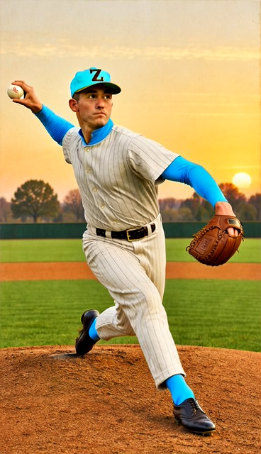</a> 0.98</td></tr>
</table>

*Card: [Cy Young, Cleveland Naps, baseball card portrait], card set White Borders (T206), issued by the American
Tobacco Company, 1909–1911. Library of Congress, Prints and Photographs Division, Benjamin K. Edwards Collection;
no known restrictions on publication.
[loc.gov/pictures/item/2008676577](https://www.loc.gov/pictures/item/2008676577/){:target="_blank"}*

What to notice:

- **Up to 0.5, the card barely changes,** however different the prompt.
- **From 0.75 to 0.90, the prompt takes over the details** (the pinstripes, the blue sleeves and collar, the blue
  cap with its Z) while the card's pose, framing, and border stay.
- **At 0.95, it's a new person on a similar card,** and **at 0.98, a new picture** that keeps only the colors and
  the general idea. Here MOSS-Image also shows its limits: the pitcher's cross-body throw isn't a real pitching
  motion.
- **The lettering on the card becomes invented text** once Change is high enough to redraw it. Words come out
  right only when the prompt gives them in quotation marks.
