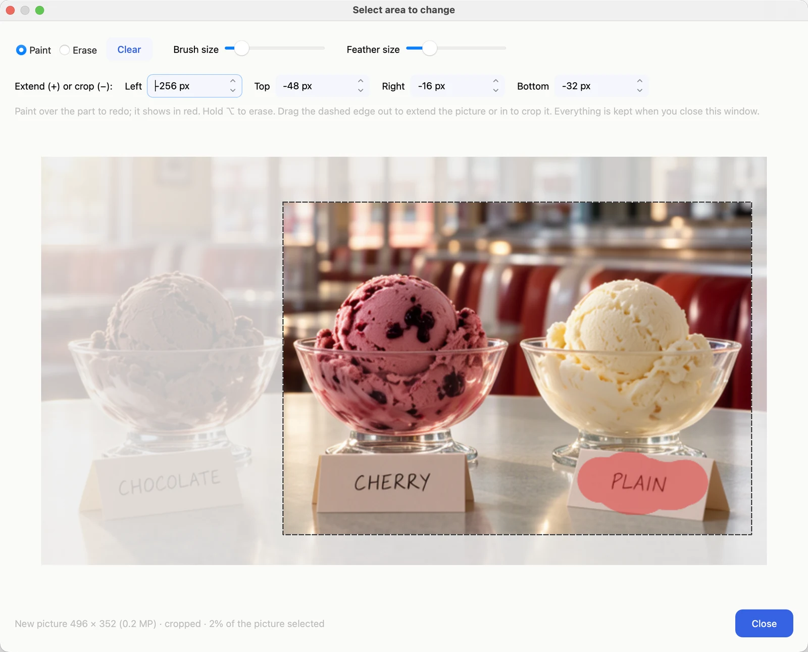
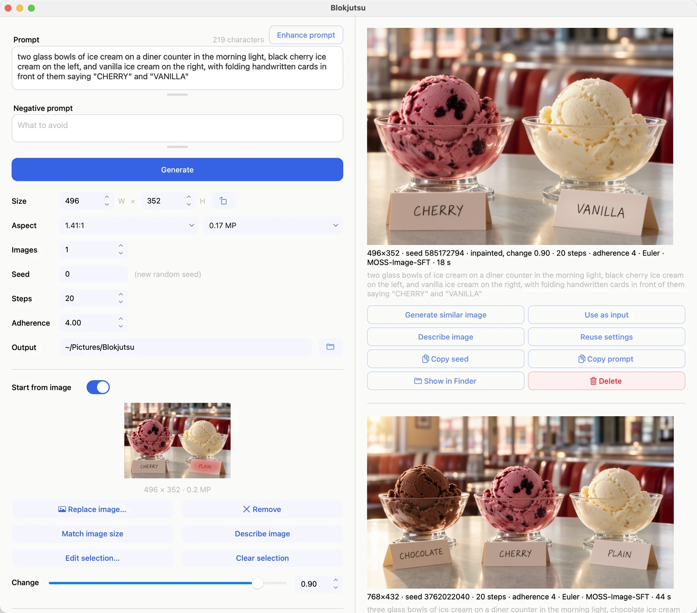

# Working from a picture

Switch on **Start from image**, then drop a picture on the box or click it to choose one. Or click **Use as
input** on any picture in your history.

Under the picture: its original size, and these buttons.

| button | does |
|---|---|
| Choose / Replace image… | picks a picture from your Mac |
| Remove | takes the picture out of the box (the file is not touched) |
| Match image size | sets Size to the picture's shape, up to about 2 megapixels |
| Describe image | writes a description you can use as the prompt |
| Select area to change… | opens the area editor (so does clicking the picture) |
| Clear selection | lets the whole picture change again |

## Change

**Change** sets how far the new picture may move from yours, from 0.01 to 1. The
[examples](examples.md#starting-from-a-picture) show a baseball card across the range.

| Change | result |
|---|---|
| 0.01–0.05 | almost identical: cleaner, sharper, slightly retouched |
| 0.05–0.2 | same picture, restyled or with details redone |
| 0.25–0.5 | same composition and colors, new content |
| 1.0 | only the prompt matters; your picture is ignored, except outside a selected area |

## Prompting

The prompt matters at every setting of **Change**: describe the picture you want to end up with, not the change
you want made. **Describe image** is a quick way to get a prompt that matches your picture, ready to edit.

## Changing part of a picture

**Select area to change…** opens the area editor.

Here the picture is cropped to two bowls, and the card reading PLAIN is painted, ready for a prompt that says
"VANILLA" instead.

- **Paint** over what should change; it shows in red. **Erase**, or hold ⌥ while painting, removes paint.
  **Clear** removes it all.
- **Brush size** and **Feather size** (how softly the new part blends in) are beside them.
- Close the window however you like; the selection is kept and shows in red on the picture.

Then write a prompt for the whole picture as it should end up, set **Change**, and **Generate**. Only the
selected area changes; the rest stays exactly as it was.

- Replace something: **Change 1.0**, and a prompt describing what should be there
- Fix or restyle something: **Change 0.2–0.5**

The prompt now names the cards "CHERRY" and "VANILLA". On the left, **Start from image** shows the cropped picture
with the painted card; on the right, the result, with the original below it.

## Extending and cropping

In the same editor, **Extend (+) or crop (−)** adds space to any side, or trims it. Or drag the dashed edge:
outward to extend, inward to crop. Cropped parts show faintly; new space shows in red. Paint under a cropped part
is kept, so you can adjust the crop and the paint in either order; only what is inside the frame is used.

New space is always filled in from scratch to match the picture, so Blokjutsu sets **Change** to 1.0 when you
extend. A crop alone simply gives you a smaller starting picture.

## Upscaling: making a picture bigger

MOSS-Image makes a good upscaler:

1. **Start from image** with the picture, then **Match image size**.
2. In the **MP** menu, choose ×1.5, ×2, or more (up to about 4 megapixels).
3. Set **Change** low: **0.01** keeps the picture exactly and sharpens it, quickly; **0.05–0.1** lets the model
   add new fine detail, more slowly.
4. Use the picture's own prompt (**Reuse settings**, then switch Start from image back on) or **Describe image**.
