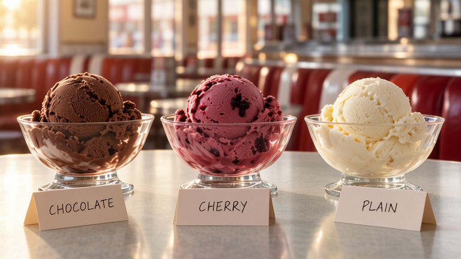
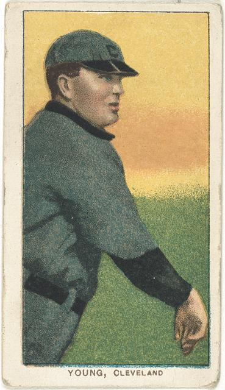
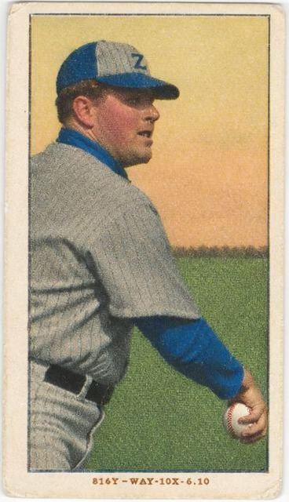
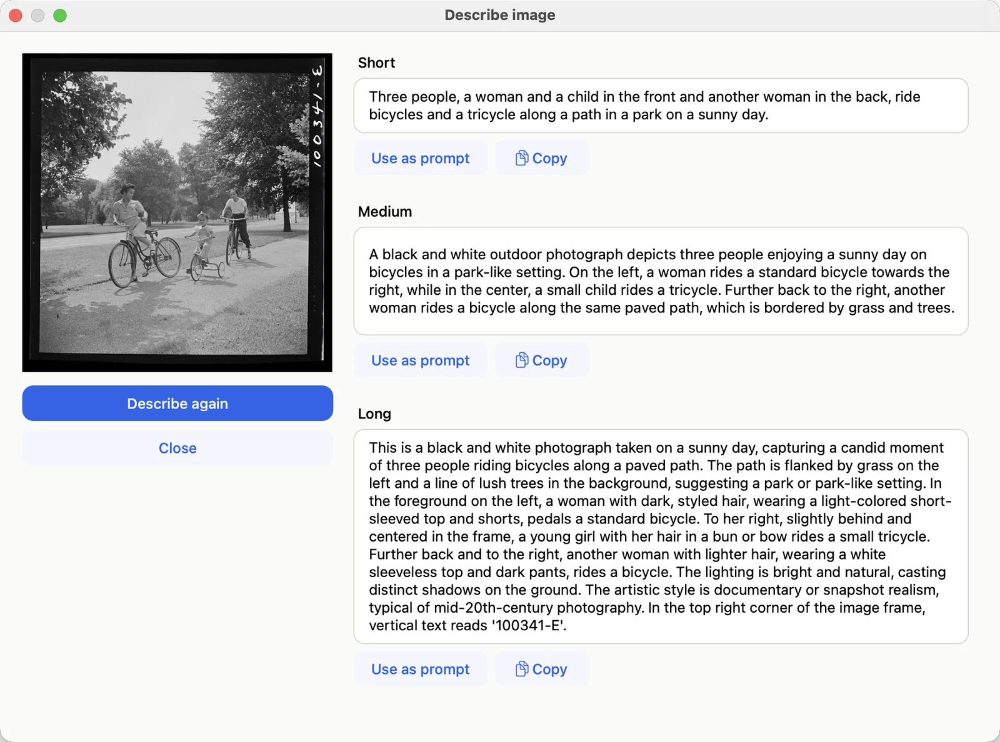

<section class="hero">
  <h1>Make and edit pictures from a description, on your Mac.</h1>
  <figure>
    
    <figcaption>
      three glass bowls of ice cream on a diner counter in the morning light, chocolate ice
      cream on the left, black cherry ice cream in the middle, and vanilla ice cream on the right, with folding
      handwritten cards in front of them saying “CHOCOLATE”, “CHERRY” and “PLAIN”
      768 × 432 · 20 steps · 44 seconds on a Mac Studio (M3 Ultra) ·
      <a href="performance.html">other Macs</a>
    </figcaption>
  </figure>
</section>



<aside class="based-on">
  
<strong>Built on MOSS-Image.</strong> Blokjutsu is a Mac app for
  <a href="https://github.com/OpenMOSS/MOSS-Image">MOSS-Image</a>, an open-weight image model from the OpenMOSS
  Team and MOSI.AI. All of the picture-making is theirs. Blokjutsu is an independent project and is not
  affiliated with either.

  
<a href="credits.html">Credits and licenses</a>

</aside>

## Change a picture

  <figure><figcaption>Start from a picture: a 1909–1911 baseball card</figcaption></figure>
  <figure><figcaption>Describe the picture you want: a modern color card, red hat, golden-hour sunset</figcaption></figure>

Keep the pose and change everything else, or paint over one part and change only that.

[Working from a picture](from-a-picture.md) [More examples](examples.md#starting-from-a-picture)
{: .more}

## Describe a picture

Three descriptions of a 1942 photograph, short to long, each ready to use as a prompt.

[Describing images](describing.md)
{: .more}

## The whole app

One window. Every picture is saved with its prompt and settings, and any of them can be the start of the next.

[Getting started](making-images.md)
{: .more}

## Stays on your Mac

Blokjutsu runs MOSS-Image on your Mac's own processor and memory. Prompts and pictures never leave it; the
internet is used only to download the model, when you ask.

[What runs where](local.md)
{: .more}
