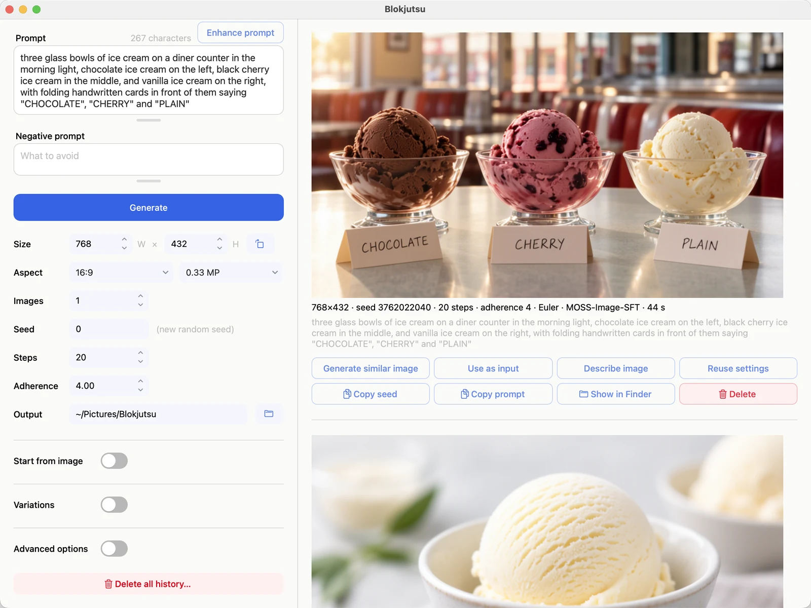

# Blokjutsu

Blokjutsu is a local, permissively licensed, open-source Mac app for generating and editing images from text
prompts with the open-weight MOSS-Image model. You describe a picture, press **Generate**, and after the selected
number of steps it appears. You can also start from a picture of your own: change all of it, repaint part of it,
extend it, crop it, or make it bigger.

[Download for Mac](https://github.com/formdo/blokjutsu/releases/download/v1.0.0rc2/Blokjutsu-1.0.0rc2.dmg){: .btn .btn-primary }
[Other ways to install](install.md){: .btn }
[Your first picture](first-picture.md){: .btn }

## What it is

- **Simple on purpose.** A small set of controls designed to work together and to be quick to learn.
- **Local.** The model runs on your own Mac. You never send your prompts, your pictures, or the pictures you start
  from to a company, and nobody meters or rations your use.
- **Permissive open source (Apache 2.0).** Blokjutsu, MOSS-Image's code, and its model weights are all under the
  Apache License 2.0: free to use, study, change, and share, for any purpose, with no restrictions on what you
  make. See [Credits and licenses](credits.md#open-source).
- **Download once.** The picture model and the optional captioning model are downloaded once, when you ask.
  After that, everyday use doesn't go online at all.
- **Built on MOSS-Image.** The picture-making is done by
  [MOSS-Image](https://github.com/OpenMOSS/MOSS-Image){:target="_blank"}, an open-weight model by the
  [OpenMOSS Team](https://github.com/OpenMOSS){:target="_blank"} and [MOSI.AI](https://mosi.cn/){:target="_blank"} that is
  especially good at text inside pictures and at following long, detailed descriptions. Blokjutsu is an
  independent app around it. See [Credits](credits.md).

## What you need

| | |
|---|---|
| Mac | Apple silicon (M1 or later), macOS 12.3 or later |
| Memory | 32 GB or more; 48 GB or more is comfortable ([why](performance.md)) |
| Disk | about 40 GB free, mostly for the model |
| Internet | only for installing and the one-time model download |

## This guide

1. [Install and Uninstall](install.md): the installer, the model download, uninstalling
2. [Your first picture](first-picture.md): a tour of the window
3. [Writing prompts](prompts.md): what MOSS-Image responds to
4. [Controls](controls.md): every setting, in plain terms
5. [Menus](menus.md): everything in the menu bar
6. [Examples](examples.md): what the settings do, side by side
7. [Working from a picture](from-a-picture.md): changing, repainting, extending, cropping, and upscaling
8. [Variations](variations.md): exploring around a picture you like
9. [Your history](history.md): finding, reusing, and sharing pictures
10. [Speed and memory](performance.md): how long images take, and how much memory they need
11. [Running locally](local.md): what goes online, and where Blokjutsu keeps things
12. [Troubleshooting](troubleshooting.md) and [questions](faq.md)

## Etymology

**Blokjutsu** (BLOK-joot-soo, /ˈblɒk.dʒuː.tsuː/), *noun*. The art of the block.

From Danish *blok*, "block," and Japanese *jutsu* (術, じゅつ), "art" or "technique." The name comes from how
MOSS-Image works: it treats an image as blocks of pixels, each 16 × 16 square one unit for the model, and
transforms them step by step from noise into the finished image.

## Design inspiration

The block designs in the icon and the app draw on

- the [Kohs block design test](https://en.wikipedia.org/wiki/Kohs_block_design_test){:target="_blank"},
  introduced by Samuel C. Kohs in 1920: colored cubes, some faces split diagonally, arranged to match a pattern
- [Froebel's gifts](https://en.wikipedia.org/wiki/Froebel_gifts){:target="_blank"}, the wooden building blocks of
  Friedrich Fröbel's first kindergartens
- the primary colors and simple geometry of the [Bauhaus](https://en.wikipedia.org/wiki/Bauhaus){:target="_blank"}
