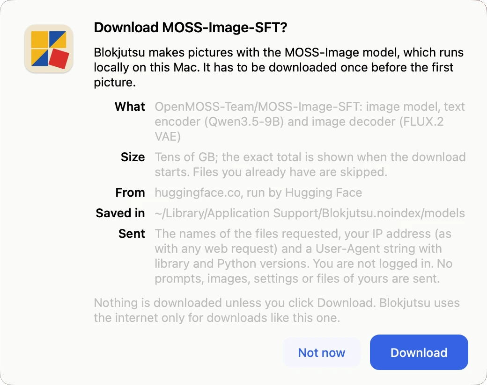

# Install and Uninstall

  <a class="btn btn-download" href="https://github.com/formdo/blokjutsu/releases/download/v1.0.0rc2/Blokjutsu-1.0.0rc2.dmg">Download for Mac</a> 
  Blokjutsu 1.0.0rc2 · about 360 MB · for Macs with Apple silicon

## Installing

1. Open the downloaded `Blokjutsu-1.0.0rc2.dmg`. A window opens with Blokjutsu and your Applications folder.
2. Drag **Blokjutsu** onto **Applications**.
3. Eject the disk image (in the Finder sidebar), and move it to the Trash if you like.
4. Open Blokjutsu from Applications, Launchpad, or Spotlight. The first time, macOS says it was downloaded from
   the internet and asks whether to open it; click **Open**. Apple has checked it, so this is the only question.

## The model download

The first time Blokjutsu opens, it asks before downloading the MOSS-Image model: about 30 GB from
[Hugging Face](https://huggingface.co), a site that hosts open AI models. The dialog says exactly what is fetched
and what is sent. Click **Download**, or **Not now** to do it later from **File → Download Model…**.

{: width="520" }

The download takes a while on a typical home connection. You can cancel it; when you start again it carries on
where it left off. The model is stored in Blokjutsu's own folder, which is kept out of Time Machine backups and
Spotlight ([why, and how to change it](local.md#backups-and-spotlight)).

[Describing images](describing.md) and Enhance prompt need one more, smaller download (2 GB), offered the first
time you use them.

## Updating

Download the new version and drag it onto **Applications** as before, choosing **Replace**. Your pictures,
settings, and the model are kept. Each Blokjutsu release uses the model version it was tested with and fetches a
newer one only if that release moves to it.

## Uninstalling

Drag **Blokjutsu** from Applications to the Trash. That removes the app, but keeps your pictures, your
settings, and the model.

The model takes about 30 GB. To remove it as well, with everything else Blokjutsu keeps:

1. In Finder, choose **Go → Go to Folder…**, type `~/Library/Application Support`, and press Return.
2. Move the folder `Blokjutsu.noindex` to the Trash, and empty the Trash.

That folder also holds the pictures in the default Output folder, so move any you want to keep first. Pictures in
an Output folder you chose yourself are not in it.

Other ways to install, from Terminal or with Python, are described in the
[README on GitHub](https://github.com/formdo/blokjutsu#install).
