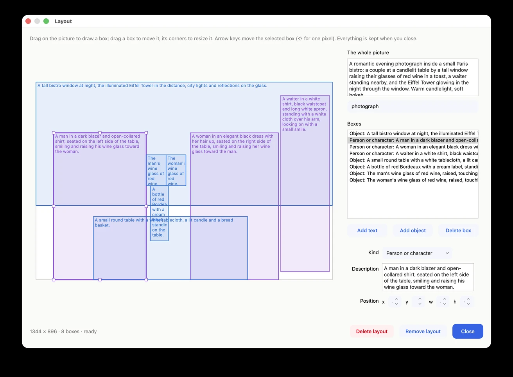
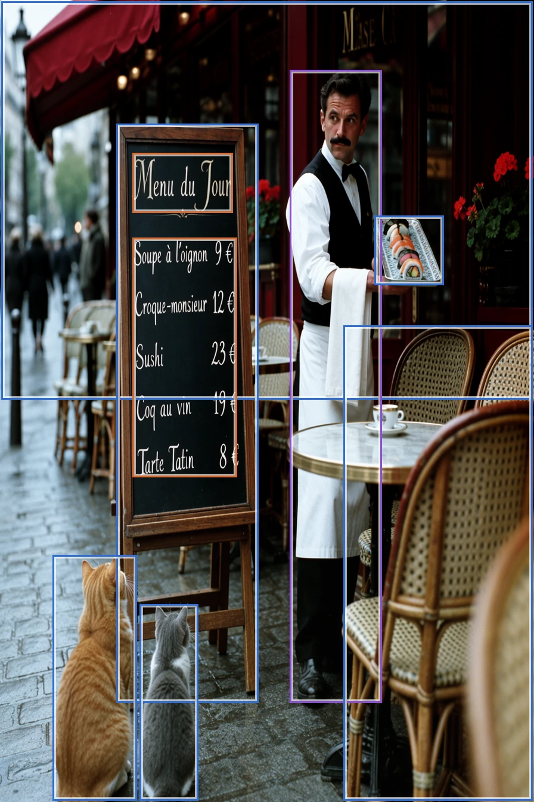
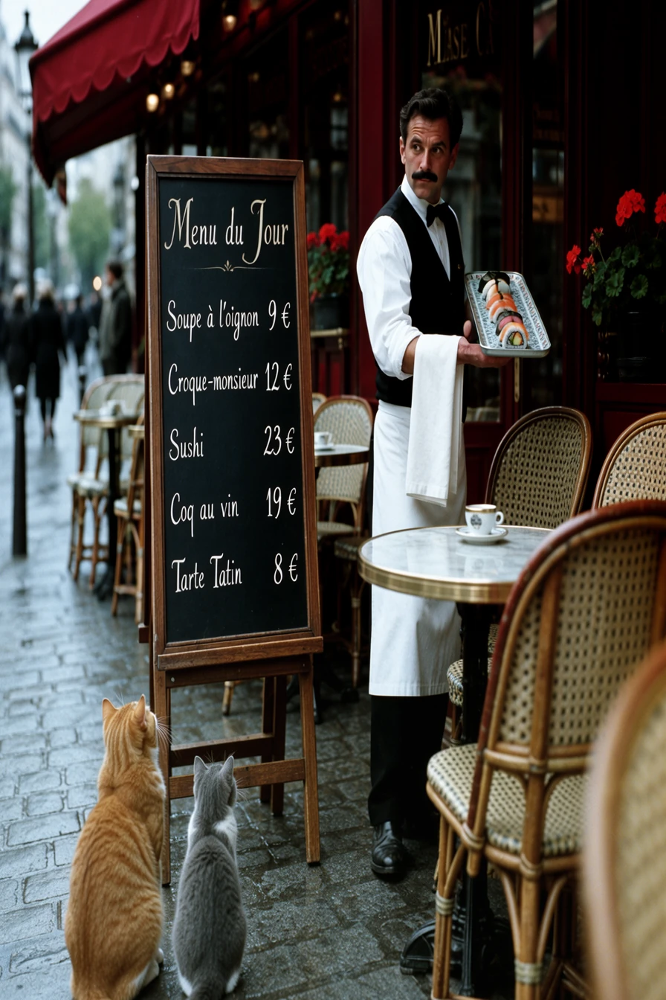
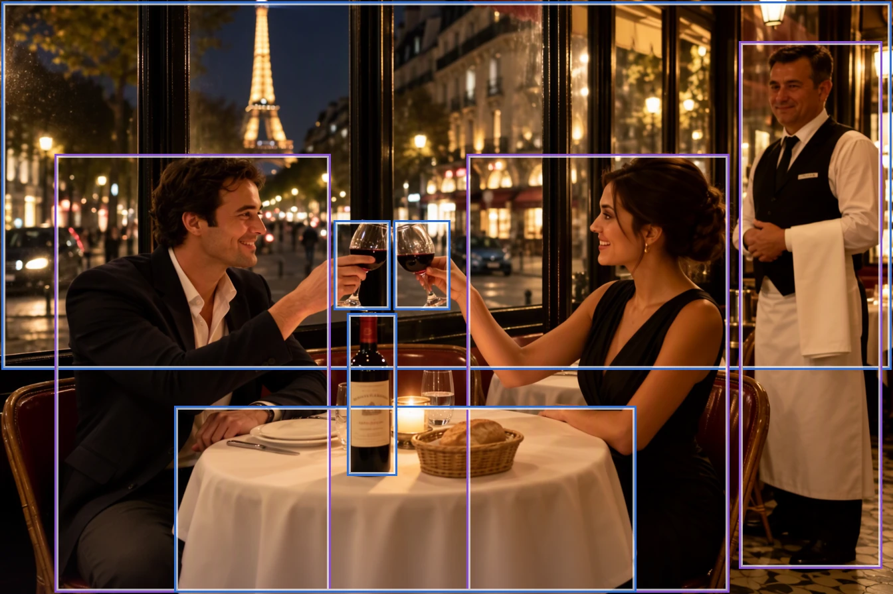
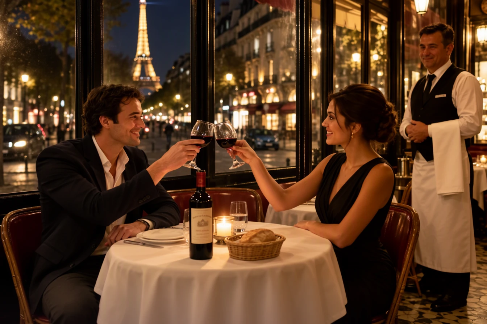

# Layouts

A layout says where things go. You draw boxes on the picture and say what each one holds: an object, a person or
character, or words. MOSS-Image follows the boxes closely: things land in their boxes, and lettering is sized
to fill its box.

## Making a layout

1. Set the picture's **Size**. (You can change it later; the boxes stretch with the picture.)
2. Click **Layout…** beside the prompt. Whatever you had typed becomes the description of the whole picture.
3. Drag on the picture to draw a box. On the right, choose what kind of box it is and describe it. For a text
   box, type the exact words; press Return for a new line.
4. Describe the whole picture at the top: subject, setting, style, light.
5. Close the window and **Generate**.

The line at the bottom of the window says what's still missing, such as a box with no description.

## Moving and resizing boxes

- Drag a box to move it, and drag its corners or sides to resize it. Edges and centers snap to the picture and to
  each other, shown by pink lines.
- The arrow keys move the selected box 16 pixels at a time, or 1 pixel with ⇧. Delete removes it. **Position**
  shows its exact place and size.
- Where boxes overlap, a click picks the smallest one, so you can pick the words on a sign from inside the sign.

## Tips

- **A text box's size is the lettering's size.** Draw a big box for a big title, a small one for small print.
  Lines that should stay together go in one box; lines placed separately get their own boxes.
- **Say how things look in each box's description**: for text, the lettering (chalk, painted, bold, its color).
- **Boxes can overlap.** The words on a sign go inside the sign's box.
- **Many boxes?** An **Adherence** of 6 holds them more firmly.

## Examples

  <figure><figcaption>The boxes, drawn over the picture made from them</figcaption></figure>
  <figure><figcaption>The picture</figcaption></figure>

A Paris café, 896 × 1344, nine boxes. The menu is one text box: five lines in chalk, word for word, with the
prices lined up. The sushi on the menu and on the waiter's tray, in its own small box, were added to see whether
the model would follow a layout that made no sense for a French café. It did.

  <figure><figcaption>The boxes</figcaption></figure>
  <figure><figcaption>The picture</figcaption></figure>

Dinner in Paris, 1344 × 896, eight boxes: the window, the man, the woman, the waiter, the table, the bottle,
and a box for each glass, side by side, so the glasses meet in a toast.

## Using, setting aside, and deleting a layout

- While a layout is in use, the prompt box shows its description and how many boxes it has. Click it to edit.
- **Remove layout** goes back to the typed prompt. The layout is kept, even after you quit, and **Layout…**
  brings it back.
- **Delete layout** throws it away. It only asks first if the layout would be lost for good: if a picture was made
  from it as it is, it's deleted at once.
- Every picture made from a layout keeps it. **Edit layout** on the picture's card puts its settings back and
  opens the layout with the picture behind the boxes, so you can see what to nudge. **Reuse settings** brings
  the layout back too.

## Pasting a layout

A layout written as JSON, such as the examples in the [MOSS-Image User
Guide](https://github.com/OpenMOSS/MOSS-Image/blob/main/USERGUIDE.md#layout-prompts-experimental){:target="_blank"},
can be pasted as the prompt; click **Layout…** to open it in the editor. The format is described in
[For developers](developers.md#json-layouts).
