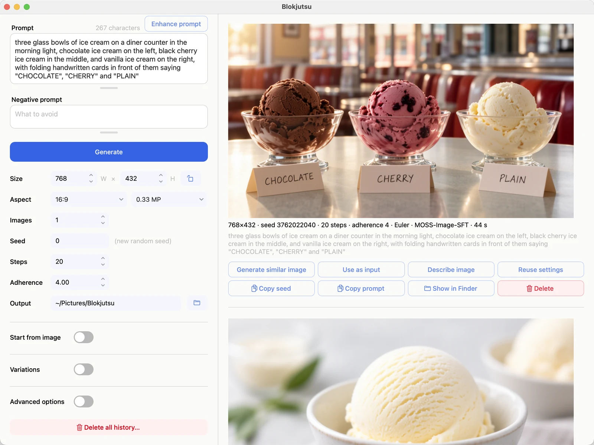

# Getting started

1. Type a description in **Prompt**, for example:

   > three glass bowls of ice cream on a diner counter in the morning light, chocolate ice cream on the left,
   > black cherry ice cream in the middle, and vanilla ice cream on the right, with folding handwritten cards in
   > front of them saying "CHOCOLATE", "CHERRY" and "PLAIN"

2. Press **Generate** (or ⌘-Return).
3. A card appears on the right. It shows the step it's on, the time taken so far, and the time left, and a
   preview that sharpens as it goes. **Cancel** stops it.

Every picture is saved automatically, with all of its settings, in the **Output** folder.

## What to try next

- Press **Generate** again: you get a different picture, because the **Seed** is new each time.
- Make the prompt longer and more specific. MOSS-Image rewards detail; see [Writing prompts](prompts.md).
- Click **Enhance prompt** to have the model write a more detailed version of your prompt.
- On a picture you like, click **Generate similar image** for close [variations](variations.md).
- Click **Use as input** to [start a new picture from it](from-a-picture.md).
- Click the bold name of any control, such as **Seed** or **Change**, for a one-line explanation.
- See what each setting does, side by side, in the [Examples](examples.md).
