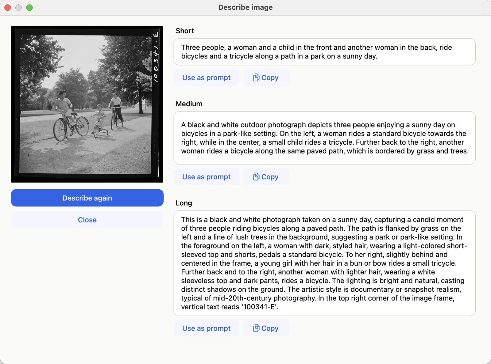

# Writing prompts

MOSS-Image was trained on long, careful descriptions of pictures. It does best when you write like that too.

## Describe, don't command

Say what is in the picture, where, and how it looks: subject, setting, composition, colors, light, and style.

| instead of | try |
|---|---|
| a cat | A ginger cat asleep on a windowsill, curled in a patch of afternoon sun, potted herbs beside it, soft focus background, warm film photograph |
| poster for a jazz night | A 1950s-style jazz poster: a silhouetted saxophonist in deep blue on a mustard background, the title "BLUE NOTE NIGHT" in large white letters at the top, "Friday 9 pm" in small letters at the bottom |

English works best; other languages, Chinese in particular, also work.

## Text in pictures

MOSS-Image is unusually good at writing. Put the exact words in quotation marks and say where they go. To
control line breaks, start new lines in the prompt itself:

```text
A handwritten note on a fridge door:
"Milk
Eggs
Bread"
```

## Negative prompt

**Negative prompt** lists what you don't want. MOSS-Image's authors suggest:

```text
worst quality, bad anatomy, watermark, jpeg artifact
```

Leave it empty if you don't need it.

## Tags

Short comma-separated tags also work, for example `best quality, watercolor, lighthouse, stormy sea, gulls`.
Put quality words first and subject words last.

## Layouts

For precise placement you can give the prompt as a JSON layout: an overall caption plus boxes, each with a
description and, for text, the exact words. This example is for a 1024 × 1024 picture:

```json
{
  "summary": {"meta": ["poster"], "canvas": "single",
              "caption": "A minimalist travel poster, cream background, a blue mountain, the title EXPLORE."},
  "items": [
    {"label": "text", "caption": "Large dark-blue capitals, centered at the top.", "text": "EXPLORE",
     "bbox": [-416, -384, -288, 384]},
    {"label": "object", "caption": "A flat blue mountain illustration.", "bbox": [-192, -288, 384, 288]}
  ],
  "bbox_coord_space": "abs_centralized",
  "bbox_format": "yxyx"
}
```

Each `bbox` is a box given by four numbers, `[top, left, bottom, right]`, in pixels measured from the center of
the picture: left and up are negative, right and down are positive. On a 1024 × 1024 picture both directions run
from −512 to 512, so `[-416, -384, -288, 384]` is a wide strip near the top. To convert from the usual
top-left corner coordinates of an image editor, subtract half the width from *x* and half the height from *y*.

`"bbox_coord_space": "abs_centralized"` (pixels from the center) and `"bbox_format": "yxyx"` (top, left, bottom,
right) say how to read the boxes. They are the only values MOSS-Image currently documents, so keep them as they
are. You can also mix a layout with ordinary sentences in the same prompt.

Blokjutsu checks the JSON before generating and warns if the boxes don't fit the picture size. Layouts are
experimental in MOSS-Image; the [MOSS-Image User Guide](https://github.com/OpenMOSS/MOSS-Image/blob/main/USERGUIDE.md#layout-prompts-experimental)
has the details.

## Let the model help

- **Enhance prompt** (above the prompt box) rewrites your prompt in three lengths. Pick one with
  **Use as prompt**; ⌘Z brings your own prompt back.
- **Describe image** writes a description of any picture, a good starting prompt for something similar.



Describe image on a 1942 photograph. The long description even reads the negative number in the corner.
*Photograph: Marjory Collins, "Sunday cyclists in East Potomac Park, Washington, D.C.", June–July 1942. Library of
Congress, Farm Security Administration/Office of War Information collection; public domain.
[loc.gov/item/2017825632](https://www.loc.gov/item/2017825632/)*

The character count beside each box is just for reference; MOSS-Image reads up to about 4,000 tokens (roughly
15,000 characters). The limit can be lowered with **Max tokens** in Advanced options.
