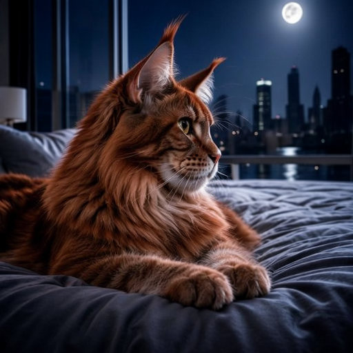
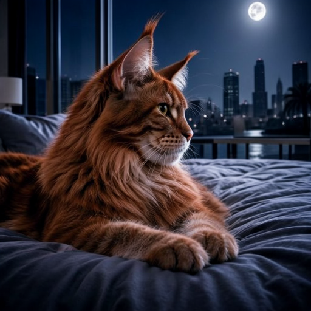
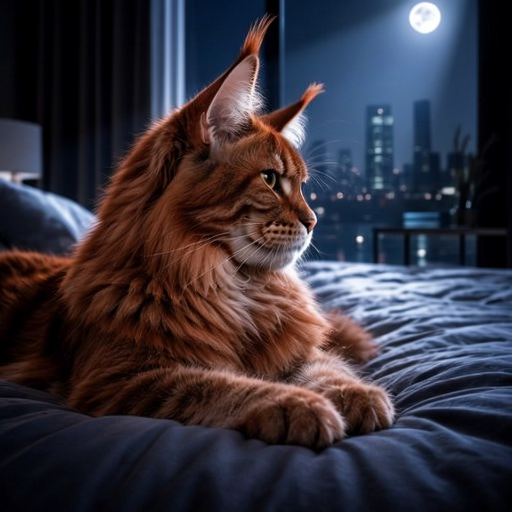
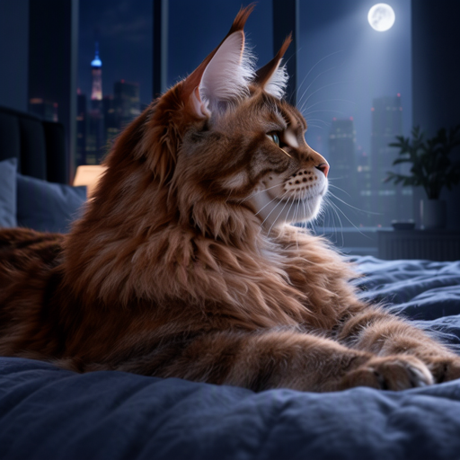
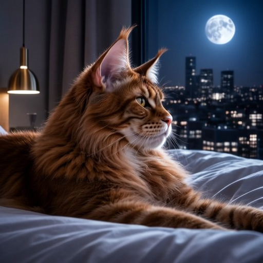
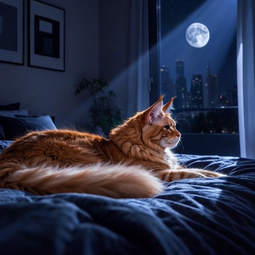

# Variations

A new seed gives a completely different picture. Variations give pictures *close* to one you have selected as a basis.

## From a picture in your history

Click **Generate similar image** under it. Blokjutsu loads its settings, switches on **Variations**, and makes
**Images** many variations.

## The Variations controls

- **Strength**: how different each variation is ([examples below](#what-strength-does)). 0.05 is a subtle nudge, 0.2 (the default) a clear variation,
  0.5 and above a loose relative.
- **Variation seed**: 0 means new variations every time; a number repeats the same ones.

## What Strength does

**Variations** at strengths 0, 0.10, 0.25, 0.50, 0.75, and 1.00, all from the same picture: the cat seed from
[Samplers and steps](examples.md#samplers-and-steps) with a new prompt. 512 × 512, Adherence 4.

> side view of a red tabby Maine coon cat lying on a bed in moonbeam, sleek modern apartment, digital RAW

<table class="examples">
  <tr><td> 0 (the original)</td><td> 0.10</td><td> 0.25</td></tr>
  <tr><td> 0.50</td><td> 0.75</td><td> 1.00</td></tr>
</table>

What to notice:

- **Up to about 0.25, it's the same picture** with small changes: the skyline, the moon, the fur.
- **At 0.5 and 0.75, the room and the light change** while the idea stays.
- **At 1.0, it's a new picture,** as different as a new seed.

[All the examples](examples.md)
{: .more}

## Exploring

Click **Generate similar image** on a variation to vary it again. Each step is recorded with the picture, so any
picture in the chain can be made again exactly.
